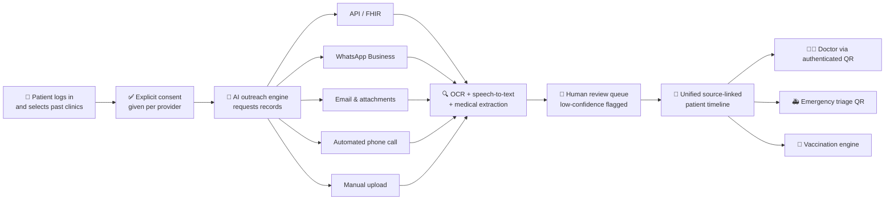
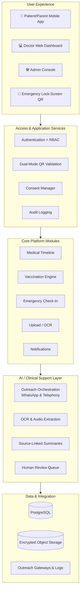

# 🩺 Memora

### One portable, patient-owned medical record that *finds* your history, *protects* your children, and *speaks up* in an emergency.

**AI-Assisted Patient Records · Pediatric Vaccination · Emergency Support**

[The Problem](#-the-problem) · [Our Solution](#-our-solution) · [Features](#-features) · [AI](#-ai-capabilities) · [Architecture](#-architecture) · [Roadmap](#-roadmap) · [Market](#-market--competitors)

---

## 📌 At a Glance

| | |
|---|---|
| **What is it?** | A unified digital medical record platform (patient mobile app + doctor web dashboard) that gathers a patient's scattered history into one source-traceable timeline. |
| **Who is it for?** | Patients, parents and guardians, doctors, clinics/labs, and platform administrators. |
| **What makes it different?** | AI that **goes and collects** your past records (with your consent), an **emergency safety net**, **national child vaccination tracking**, and **AI answers that always link back to the original document**. |
| **What it is *not*** | A diagnosis engine. AI supports clinicians. It never replaces professional medical judgment. |

---

## 🚨 The Problem

Healthcare in Egypt is digitizing under **Vision 2030** and the Universal Health Insurance System, but a patient's story is still scattered across **private hospitals, independent labs, clinics, and paper files**.

| Pain point | What it causes |
|---|---|
| 🗂️ **Fragmented records** | Doctors see only a fragment of the patient's history at consultation time. |
| 🔁 **Repeated tests** | Patients redo labs they already did, wasting money, time, and sometimes delaying treatment. |
| 📞 **Painful record collection** | Getting records from a past clinic means calls, visits, and waiting. |
| 💉 **Paper vaccination cards** | Lose the card and the child's vaccination history is hard to recover. |
| 🧓 **Limited access to care** | Elderly, ill, or less mobile patients struggle to reach a doctor. |
| 🆘 **Emergencies** | An unresponsive patient cannot tell responders their allergies, blood type, or conditions. |
| 🤖 **Trust in AI** | Medical AI that cannot show its sources is hard for clinicians to rely on. |

> **The gap:** there is no integrated, patient-centered platform that connects records across providers, tracks child vaccination, and supports emergencies, while keeping privacy, consent, and traceability intact.

---

## 💡 Our Solution

**Memora** turns fragmented medical information into **one structured, chronological, source-traceable timeline** owned by the patient.

> **Product promise:** *One portable, patient-owned record that actively aggregates past history, safeguards children through smart vaccination tracking, and protects patients during emergencies with verifiable AI assistance.*

### How it works

Instead of asking the patient to upload everything by hand, Memora **contacts previously visited clinics on the patient's behalf**, always with verified consent, and falls back to uploads whenever outreach is pending.

---

## ✨ Features

### 🧱 Core Platform (MVP)

<table>
<tr>
<td width="50%" valign="top">

#### 🗃️ Digital Patient Record
Profile, conditions, allergies, visits, lab reports and secondary medication notes in a single **source-tagged timeline**. Every item keeps an immutable link to the document it came from.

#### 🤖 AI Provider Outreach & Digitization
Pick a clinic and Memora requests your records via **API, WhatsApp Business, email, or an automated voice call** that clearly identifies itself as an AI assistant. Bilingual OCR (Arabic and English) digitizes the replies.

#### 🧐 Mandatory Human Review
Provider-retrieved items are tagged **"Reported by Provider, Pending Review"** until a patient or clinician confirms them. Voice-call data is labeled *unverified* until verified.

</td>
<td width="50%" valign="top">

#### 📲 Dual-Mode QR Access
- **Authenticated QR** lets a verified doctor open the record during a consultation, with permission control.
- **Emergency triage QR** gives first responders only essentials: **name, age, blood type, allergies, chronic conditions, current medications, smoking status, and emergency contacts**, without exposing the full record.

#### 🆘 Emergency Registration & Check-In
Fall and abnormal heart-rate detection through device sensors. If the patient is unresponsive, emergency contacts are alerted and a **triage QR** is displayed on the lock screen.

#### 👶 Child Vaccination Tracking
Due, upcoming, and overdue vaccines calculated against the **Egyptian national immunization schedule**, with reminders and downloadable certificates.

</td>
</tr>
</table>

#### 👩‍⚕️ Doctor Quick Summary
A one-page brief on scan: key conditions, allergies, recent visits, abnormal labs, and secondary medications, **each statement linked to its source document**.

### 🔐 Consent, Security & Audit (built in, not bolted on)

- ✅ Patients choose **which providers are contacted** and can **revoke access anytime**
- 🕐 Time-limited, patient-revocable QR validity
- 🧾 **Tamper-resistant audit log** of every outreach message, call, import, and doctor access
- 🔒 Encryption in transit and at rest (AES-256), role-based access control
- 🪪 Doctor verification: national ID + syndicate/license check + workplace info
- 🇪🇬 Designed around Egyptian data-protection requirements (consent logs, audit trails, DPO, local hosting where required)

### 🚀 Extended Features (Phase 2 and beyond)

| Feature | Description |
|---|---|
| 📈 **Pediatric growth tracking** | Height, weight, head circumference vs. **WHO growth standards**, percentiles, and growth flags |
| 💊 **Medication reminders** | Daily, long-term, and repeat prescriptions, with missed-dose alerts |
| 🛡️ **Clinical safety assistance** | Allergy contraindication flags, lab trend charts, structured note extraction |
| 💬 **Patient & doctor assistants** | Plain-language explanations for patients; per-patient doctor chatbot, scoped, cited, and audited |
| 🩺 **Telemedicine & nearby doctors** | Find doctors by distance, view contacts, request remote consults or home visits |
| 🧬 **Family health history** | Optional hereditary info (diabetes, hypertension, kidney disease, cancers) for risk assessment |
| 🧍 **3D Body Model (Digital Twin)** | Interactive body visualization of medical conditions |
| 🏥 **Insurance linking** | Record insurance details to speed up record discovery |
| 🎗️ **Donation awareness** | Informational gateway to verified charities; **no payments processed** |
| 🔌 **HL7 FHIR hospital integration** | Direct provider connectivity, pre-visit intake, e-prescription |

---

## 🧠 AI Capabilities

> **Golden rule:** every AI output is **limited to available data, linked to its source, and subject to verification**. No autonomous diagnosis. Ever.

| # | Capability | What it does | Approach |
|---|---|---|---|
| 1 | **Document extraction & normalization** | Standardizes data from Arabic/English documents, preserving original values | OCR (PaddleOCR / TrOCR / Tesseract) + NLP |
| 2 | **Lab report parsing** | Pulls test names, values, units, ranges; flags abnormal results; plots trends (e.g. HbA1c) | OCR + layout model + rule-based units |
| 3 | **Medical NER** | Finds diagnoses, drugs, doses, allergies, dates in free-text notes | Fine-tuned transformer (AraBERT / BioBERT-style) |
| 4 | **Medical timeline generation** | Orders events across all providers chronologically | Structured extraction + normalization |
| 5 | **Source-linked summaries** | One-page history brief, every claim linked to its source | LLM with RAG |
| 6 | **Duplicate detection & entity matching** | Merges duplicates (Arabic name variations, repeat registrations) for review, never silent deletion | Fuzzy matching + Arabic normalization + gradient boosting |
| 7 | **Conflict & data-quality detection** | Flags inconsistent or uncertain data for a human instead of auto-resolving | Rules + confidence scoring |
| 8 | **Natural-language record search** | Ask plain questions in Arabic or English, get dated, sourced results | Embeddings + vector DB + keyword search |
| 9 | **Vaccination record interpretation** | Reads old vaccination cards and compares to the national schedule | OCR + rule-based schedule engine |
| 10 | **Doctor chatbot (per patient)** | "When was the last ear infection?" Answers only from the open patient's file, with citations and audit logging | LLM with scoped RAG + permission checks |
| 11 | **Plain-language explanations** | Explains labs, diagnoses, prescriptions in simple Arabic or English | LLM grounded in the patient's record |
| 12 | **Emergency summary** | Critical-info card for the emergency QR | Rule-based extraction + fixed template |
| 13 | **Child growth & vaccine engines** | WHO z-scores and national-calendar scheduling | Deterministic (not learned models) |
| 14 | **Drug interaction & allergy alerts** | Warns before a prescription is saved | Rule engine over a drug knowledge base |

> 💬 Deterministic components are intentional: safety-critical logic such as vaccine schedules, growth percentiles, and drug interactions uses **transparent rules**, not black-box models.

---

## 🏗️ Architecture

### Starting Tech Stack *(to be validated)*

| Layer | Choice |
|---|---|
| 📱 **Mobile app** | **Flutter**, `sensors_plus` for fall detection, push notifications |
| 💻 **Doctor / admin web** | React / Next.js |
| ⚙️ **Backend / API** | Node.js (NestJS) or ASP.NET Core, with async worker queues for outreach |
| 🗄️ **Data** | PostgreSQL + encrypted object storage (S3/MinIO), AES-256 at rest |
| 🤖 **AI** | OCR, speech-to-text, conversational outreach agents, retrieval-grounded summaries |
| 🔗 **Integration** | REST, WhatsApp Cloud API, telephony gateway, HL7 FHIR (R4: Patient, Immunization, MedicationRequest, AllergyIntolerance, Condition, Encounter) |
| 🔐 **Security** | RBAC, audit logs, dual-mode QR tokens |

---

## 👥 Who Uses Memora

| User | Needs | What they get |
|---|---|---|
| 🧑 **Patient / Parent** | Own records, trigger clinic outreach, track child vaccines, set emergency contacts | Mobile app, clinic directory, consent controls, vaccine schedules |
| 👩‍⚕️ **Doctor** | Quickly review verified history and emergency data | Web dashboard, authenticated QR scanner, source-linked timeline, allergy flags |
| 🏥 **Clinic / Hospital / Lab** | Answer record requests without admin burden | Responds to patient-authorized requests via WhatsApp, calls, or approved APIs |
| 🛡️ **Administrator** | Keep the system trusted and governed | Doctor verification, access logs, outreach monitoring, duplicate resolution |

---

## 🗺️ Roadmap

| Phase | Scope |
|---|---|
| **🟢 MVP / Prototype** | Digital record + source-tagged timeline · Dual-mode QR · Emergency registration & check-in · Child vaccination engine · AI outreach (simulated clinics) + bilingual OCR + human review · Doctor quick summary |
| **🟡 Phase 2** | WHO growth tracking · Allergy/safety flags, lab trends, note extraction, timeline search · Patient & doctor assistants (with audit logs) |
| **🔵 Future** | Direct HL7 FHIR hospital APIs · Pre-visit intake & doctor discovery · Verified community support (physician-verified cases, transparent donation tracking) |

> **MVP validation approach:** demonstrated with test clinics (simulated WhatsApp number, scripted calls), user-authorized emails, and patient-uploaded files, with human-verified extraction. Live hospital rollouts are a later phase.

### 📏 How we'll measure success

Provider outreach response rate · Retrieval turnaround time · OCR / speech extraction accuracy · Correction rate · Duplicate-detection precision · Emergency check-in false-positive rate · Consultation time saved

---

## 📊 Market & Competitors

The Egyptian market is crowded in **booking, pharmacy delivery, and clinic software**, but thin in one place: a **clinically rich, patient-owned record that follows the patient between clinics**, with child vaccination and AI that works on the patient's own history.

| Category | Examples | Relationship to Memora |
|---|---|---|
| Patient-held record with QR | HealthTag, MEDOC | Closest competitors, discount-led |
| Booking marketplace | Vezeeta | Scale player; records are secondary |
| Clinic software | Clinit, Doctor Soft, Daftra, and others | **Integration partners** |
| Academic AI-EHR | E-JUST prototype | Concept stage, hospital-gated |
| AI documentation | HakeemDx, AI4Docs.AI | AI layer; possible partners |
| Pharmacy / e-prescription | Yodawy, Chefaa | Partners |
| Child health trackers | Kidyflow and others | Consumer-only, no doctor link |

### 🎯 Where Memora stands out

- **Active, patient-initiated retrieval** across past clinics instead of manual upload
- **Emergency safety net**: fall/biometric check-in paired with a triage QR
- **National pediatric vaccination workflow** aligned with the Egyptian schedule
- **Source-traceable AI**: answers cite the *patient's own record*, not only general literature
- **Works with clinic software**, doesn't replace it
- **Compliance-first**: consent logs, audit trail, time-limited emergency access

> *Competitor comparison is based on public material only. A missing feature means "not evident publicly," not "absent."*

### 🏛️ Working with government initiatives

Memora is designed to **complement**, not compete with, national programs: the National Digital Health Strategy 2025–2029, Universal Health Insurance, the national immunization registry, digital prescription, and the Doctors Syndicate QR/registry. Integration is planned in three steps: **align now** (open standards, consent, audit) → **pilot by agreement** → **plug in when national platforms open**. We never scrape government systems or present the app as an official service.

---

## ⚠️ Challenges We're Planning For

| Risk | Our response |
|---|---|
| Government platform absorbs the use case | Win private clinics + child pathway first; integrate via open standards |
| No public integration API | Be useful on day one with outreach, uploads, and FHIR-ready design |
| Clinician trust in AI | Drafts only, one-tap source checks, clinician approval, full logs |
| Data-protection licensing | Consent logs, DPO, local hosting, compliance plan from the start |
| Doctor adoption | Free entry tier, works alongside existing software |
| Cost of foreign-priced hosting/AI vs. EGP revenue | Revenue from doctors, clinics, and B2B partners; free core for patients |

---

## 🧭 Principles

1. **Patient-owned.** The patient decides who sees what, and can revoke at any time.
2. **Traceable.** Every fact links to its source. Nothing is invented.
3. **Verified.** Imported data stays provisional until a human confirms it.
4. **Supportive AI.** Assists clinicians, never diagnoses.
5. **Private by design.** Encryption, audit trails, minimal emergency exposure.
6. **Local first.** Arabic and English, Egyptian schedules, Egyptian regulation.

---

## 👨‍💻 Team

> *Add your team members, supervisor, university, and faculty here.*

| Name | Role |
|---|---|
| _Name_ | _Role_ |
| _Name_ | _Role_ |

**Supervisor:** _Name_  ·  **Institution:** _University / Faculty_

---

## 📚 References

- [WHO Child Growth Standards](https://www.who.int/tools/child-growth-standards)
- [WHO recommendations on digital interventions](https://www.who.int/publications/i/item/9789241550505)
- [WHO SMART Guidelines (interoperable digital health)](https://www.who.int/teams/digital-health-and-innovation/smart-guidelines/)
- [Vezeeta public service overview](https://www.vezeeta.com/en)

---

## ⚖️ Disclaimer

Memora is an academic graduation project. It is **not a medical device**, does not provide diagnosis or treatment, and is not an official government service. All AI-generated content is informational, source-linked, and must be verified by a qualified healthcare professional.

**Made with ❤️ for patients, parents, and the doctors who care for them.**

